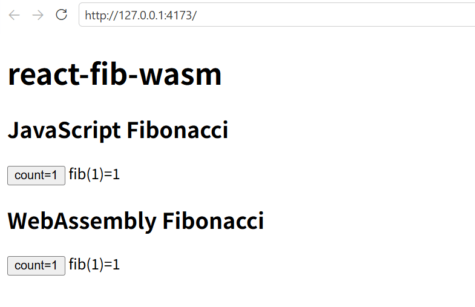

# react-fib-wasm

WASM で書いた非同期関数を React で使うサンプル。

関数はこれ:  
[heiwa4126/fib-wasm: Rust でフィボナッチ関数を書いて、wasm としてビルドしたものを、npm パッケージにする話](https://github.com/heiwa4126/fib-wasm)

非同期による更新をラップするため、
[Tanstack Query](https://tanstack.com/query/latest)
を使っている。

## 実行

```sh
vp i
vp dev
vp build && vp preview
```

### 表示例



上は TypeScript だけで書いたボタン

クリックするたび増加した値でフィボナッチ数を計算する。

## メモ

ちゃんと wasm を使うか確認用に、
[vite.config.ts](vite.config.ts) の
`assetsInlineLimit: 0`
で WASM の埋め込みを止めてます。
実用時にはここをコメントアウトしてください。

あと React 関連は CDN から呼ぶ設定になってます。
